

  <picture>
    <source media="(max-width: 480px)" srcset="assets/hero-mobile-themed.svg" />
    <source media="(prefers-color-scheme: light)" srcset="assets/hero-light.svg" />
    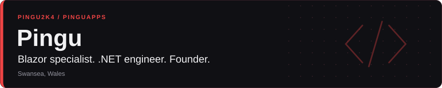
  </picture>

I'm Matthew, better known as **Pingu** — a .NET engineer and founder based in Swansea, Wales.

<table>
  <tr>
    <td width="112" align="center">
      <picture><source media="(prefers-color-scheme: light)" srcset="assets/skills/blazor-light.svg" /></picture>
    </td>
    <td>
      <h3>Blazor is my specialism.</h3>
      
I build Blazor applications, reusable components and tools that make working with Razor easier. My open-source projects tackle the details behind a maintainable Blazor codebase: consistent component markup, build integration, routing and sitemaps.

      
I work across the .NET stack, with Azure for hosting and Aspire for application orchestration and deployment.

    </td>
  </tr>
</table>

## Open source through PinguApps

I'm the **founder and sole owner of [PinguApps](https://github.com/PinguApps)**, where most of my open-source work lives. These projects reflect my work in Blazor and the wider .NET ecosystem.

  <picture>
    <source media="(max-width: 520px)" srcset="assets/cards/adoption-mobile-themed.svg" />
    <source media="(prefers-color-scheme: light)" srcset="assets/cards/adoption-light.svg" />
    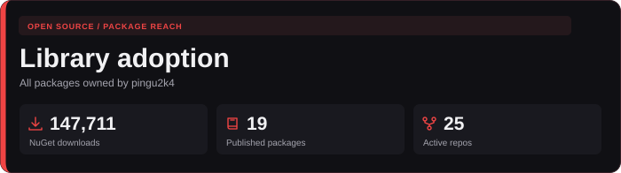
  </picture>

### Blazor tools

  <a href="https://github.com/PinguApps/RazorStyle"><picture><source media="(prefers-color-scheme: light)" srcset="assets/projects/razorstyle-light.svg" />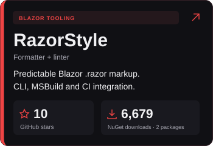</picture></a>
  <a href="https://github.com/PinguApps/BlazorSitemap"><picture><source media="(prefers-color-scheme: light)" srcset="assets/projects/blazorsitemap-light.svg" />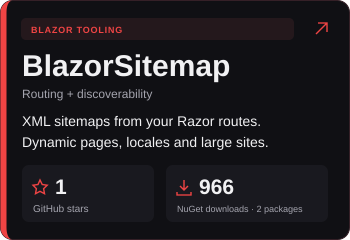</picture></a>

### Components & integrations

Reusable Blazor components and Aspire integrations for hosted services.

  <a href="https://github.com/PinguApps/Aspire.Hosting.Upstash.Redis"><picture><source media="(prefers-color-scheme: light)" srcset="assets/projects/upstash-redis-light.svg" />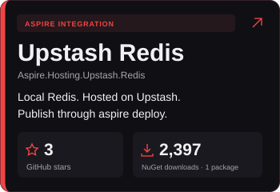</picture></a>
  <a href="https://github.com/PinguApps/Aspire.Hosting.Railway"><picture><source media="(prefers-color-scheme: light)" srcset="assets/projects/railway-light.svg" />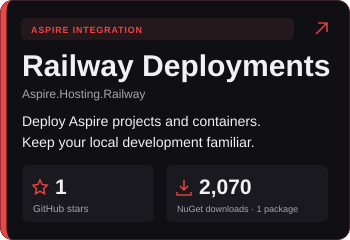</picture></a>

  <a href="https://github.com/PinguApps/Aspire.Hosting.Bunny.Storage"><picture><source media="(prefers-color-scheme: light)" srcset="assets/projects/bunny-storage-light.svg" />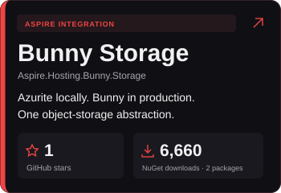</picture></a>
  <a href="https://github.com/PinguApps/Blazor.QRCode"><picture><source media="(prefers-color-scheme: light)" srcset="assets/projects/blazor-qrcode-light.svg" />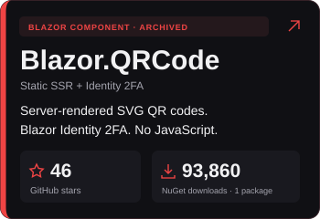</picture></a>

**Blazor.QRCode** renders SVG QR codes on the server, including static SSR and prerendering. It fits the built-in Blazor Identity authenticator setup pages without JavaScript. The repository is **archived**.

Updated daily. NuGet totals combine the packages published from each repo.

NuGet packages behind the cards

- **RazorStyle:** [build integration](https://www.nuget.org/packages/PinguApps.RazorStyle/) and [CLI](https://www.nuget.org/packages/PinguApps.RazorStyle.Cli/).
- **BlazorSitemap:** [library](https://www.nuget.org/packages/PinguApps.BlazorSitemap/) and [abstractions](https://www.nuget.org/packages/PinguApps.BlazorSitemap.Abstractions/).
- **Upstash Redis:** [hosting integration](https://www.nuget.org/packages/PinguApps.Aspire.Hosting.Upstash.Redis/).
- **Railway:** [hosting integration](https://www.nuget.org/packages/PinguApps.Aspire.Hosting.Railway/).
- **Bunny Storage:** [hosting integration](https://www.nuget.org/packages/PinguApps.Aspire.Hosting.Bunny.Storage/) and [runtime library](https://www.nuget.org/packages/PinguApps.Bunny.Storage/).
- **Blazor.QRCode:** [Blazor component](https://www.nuget.org/packages/PinguApps.Blazor.QRCode/).

## AI-native development

AI is central to my day-to-day engineering. I use **Codex, Claude and T3 Code** heavily to explore designs, implement scoped changes and review work. I define the architecture and constraints, give agents clear context, inspect the diffs and verify behaviour with tests and CI. I own the code that ships.

  <a href="https://openai.com/codex/"><picture><source media="(prefers-color-scheme: light)" srcset="assets/skills/codex-light.svg" /></picture></a>
  <a href="https://claude.ai/"><picture><source media="(prefers-color-scheme: light)" srcset="assets/skills/claude-light.svg" /></picture></a>
  <a href="https://t3.codes/"><picture><source media="(prefers-color-scheme: light)" srcset="assets/skills/t3code-light.svg" />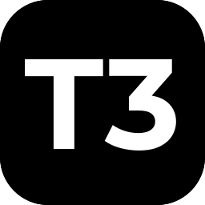</picture></a>

## My stack

**.NET & application development**

  <picture><source media="(prefers-color-scheme: light)" srcset="assets/skills/cs-light.svg" />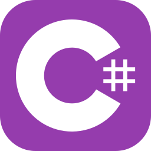</picture>
  <picture><source media="(prefers-color-scheme: light)" srcset="assets/skills/dotnet-light.svg" /></picture>
  <picture><source media="(prefers-color-scheme: light)" srcset="assets/skills/wpf-light.svg" />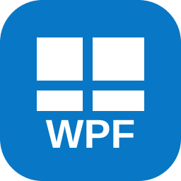</picture>
  <picture><source media="(prefers-color-scheme: light)" srcset="assets/skills/maui-light.svg" /></picture>
  <picture><source media="(prefers-color-scheme: light)" srcset="assets/skills/sqlserver-light.svg" />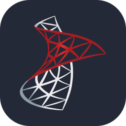</picture>
  <picture><source media="(prefers-color-scheme: light)" srcset="assets/skills/azure-light.svg" />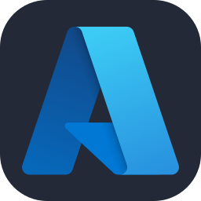</picture>
  <picture><source media="(prefers-color-scheme: light)" srcset="assets/skills/azurefunctions-light.svg" /></picture>
  <picture><source media="(prefers-color-scheme: light)" srcset="assets/skills/redis-light.svg" /></picture>

**Build, automation & hosting**

  <picture><source media="(prefers-color-scheme: light)" srcset="assets/skills/git-light.svg" /></picture>
  <picture><source media="(prefers-color-scheme: light)" srcset="assets/skills/githubactions-light.svg" /></picture>
  <picture><source media="(prefers-color-scheme: light)" srcset="assets/skills/cloudflare-light.svg" /></picture>
  <picture><source media="(prefers-color-scheme: light)" srcset="assets/skills/powershell-light.svg" /></picture>
  <picture><source media="(prefers-color-scheme: light)" srcset="assets/skills/pnpm-light.svg" /></picture>
  <picture><source media="(prefers-color-scheme: light)" srcset="assets/skills/esbuild-light.svg" /></picture>
  <picture><source media="(prefers-color-scheme: light)" srcset="assets/skills/sass-light.svg" />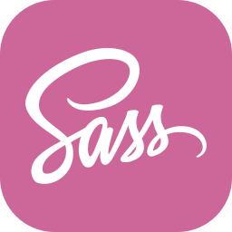</picture>
  <picture><source media="(prefers-color-scheme: light)" srcset="assets/skills/railway-light.svg" /></picture>

**Development tools**

  <picture><source media="(prefers-color-scheme: light)" srcset="assets/skills/visualstudio-light.svg" />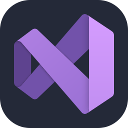</picture>
  <picture><source media="(prefers-color-scheme: light)" srcset="assets/skills/vscode-light.svg" /></picture>
  <picture><source media="(prefers-color-scheme: light)" srcset="assets/skills/unity-light.svg" />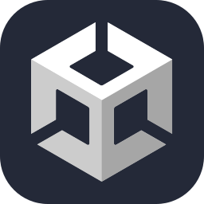</picture>
  <picture><source media="(prefers-color-scheme: light)" srcset="assets/skills/linear-light.svg" />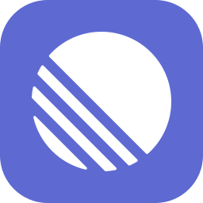</picture>

## GitHub activity

Activity across my profile and PinguApps, including private GitHub contributions. Work hosted on Azure DevOps isn't included.

Account activity totals include public activity and private activity in my account, PinguApps, OmniaBI, PinguAppsPlayground and Pink-Pixel. Contribution charts include the anonymized private counts shared on my GitHub profile.

  <picture>
    <source media="(max-width: 520px)" srcset="assets/cards/combined-weekly-mobile-themed.svg" />
    <source media="(prefers-color-scheme: light)" srcset="assets/cards/combined-weekly-light.svg" />
    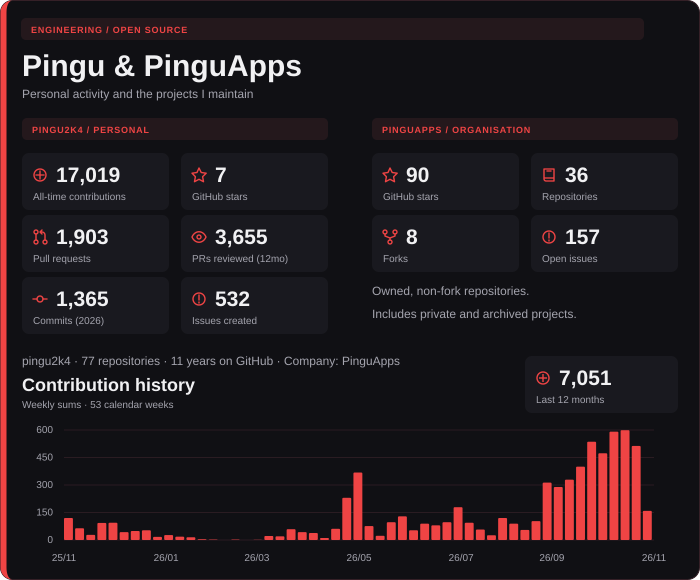
  </picture>

  <picture>
    <source media="(max-width: 520px)" srcset="assets/cards/highlights-mobile-themed.svg" />
    <source media="(prefers-color-scheme: light)" srcset="assets/cards/highlights-light.svg" />
    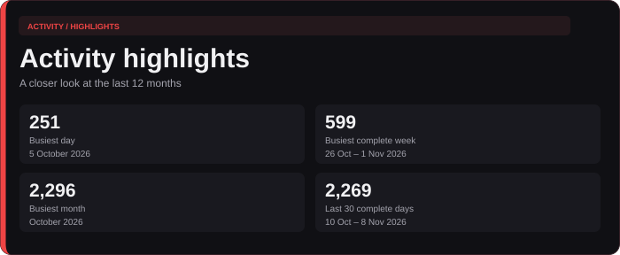
  </picture>

Calendar updated: 14 November 2026. Account, repository and package statistics refresh daily.

## Get in touch

Happy to talk about **Blazor, .NET, Azure or the projects above**.

[Email](mailto:contact@pinguapps.com) · [LinkedIn](https://www.linkedin.com/in/pingu2k4/) · [X](https://x.com/pingu2k4)

<!-- Card sources and icon attribution: ASSET-SOURCES.md. SVGs update through .github/workflows/profile-cards.yml. -->
